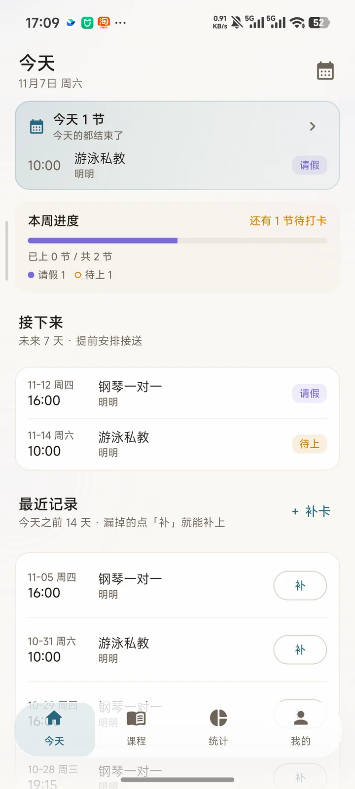
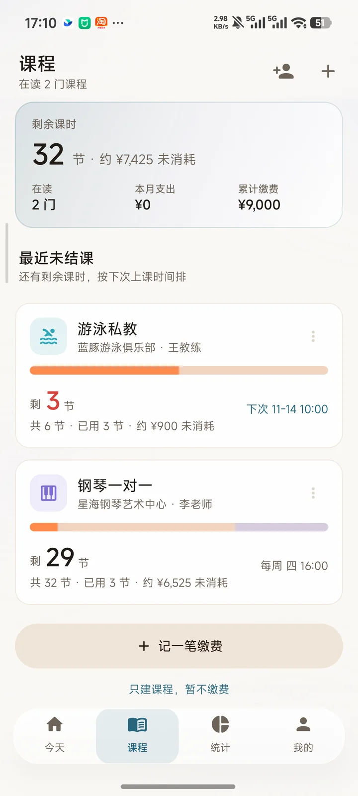
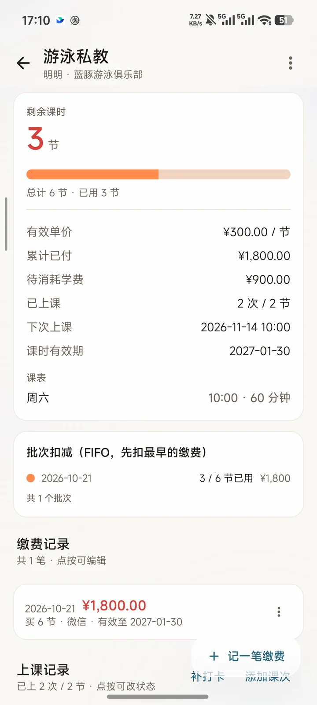
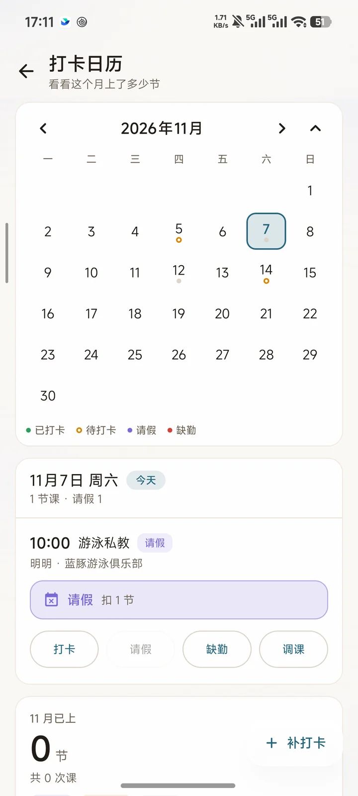
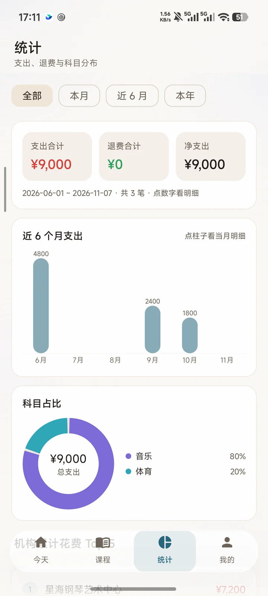
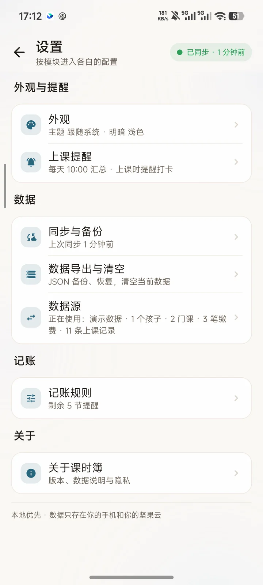

# 课时簿 · LessonLedger

<p align="center">
  <a href="https://github.com/dujunily/lesson-ledger/releases/latest"></a>
  
  
  <a href="LICENSE"></a>
</p>

> 记录孩子上了哪些课外班、每次交多少钱、还剩多少节课、这笔钱到底值不值。

一个**纯本地优先**的安卓记账 App。数据默认只存在你的手机里；要换手机或两台设备共用一份账本时，
再把它同步进**你自己的坚果云**（标准 WebDAV），不经过任何第三方服务器，也没有账号体系。

<br>

<table>
  <tr>
    <td align="center"><br><sub><b>今天</b>　今天几节课、本周进度、接下来七天</sub></td>
    <td align="center"><br><sub><b>课程</b>　剩余课时、待消耗金额、下次上课</sub></td>
    <td align="center"><br><sub><b>详情</b>　有效单价、FIFO 批次、缴费与上课记录</sub></td>
  </tr>
  <tr>
    <td align="center"><br><sub><b>打卡</b>　月历；请假、调课、缺勤各有颜色</sub></td>
    <td align="center"><br><sub><b>统计</b>　支出、近 6 月柱状图、科目占比</sub></td>
    <td align="center"><br><sub><b>设置</b>　外观、上课提醒、同步、备份</sub></td>
  </tr>
</table>

> 截图全部是内置的**演示数据**（示例孩子「明明」、示例课程「钢琴一对一」「游泳私教」），
> 不含任何真实账本内容。

<br>

## 这是什么

给家里有课外班的家长用的账本，专门解决三件很具体的事：

1. **课时记不清**：交了多少节课、上了几次、还剩多少，全靠脑子记和微信聊天记录翻。
2. **钱算不明白**：机构说「充 48 节送 4 节」，单价到底是多少？还剩的钱怎么折算？退费该退多少？
3. **提醒不到位**：今天几点有课、这个月还有几节没上，没人提醒你。

所以做成「**一门课一个账本**」：缴费记批次、上课按 FIFO 扣减、每节课都能追到具体是哪一笔钱付的。
所有金额按**分**存（`Long`）、课时按**半节**存，不用浮点，不会出现 0.1 + 0.2 那种脏数字。

<br>

## 下载安装

到 [**Releases**](https://github.com/dujunily/lesson-ledger/releases/latest) 下载最新的 `lesson-ledger-x.y.z.apk`，传到手机上点开安装即可。

- 系统要求：**Android 8.0 及以上**（minSdk 26，targetSdk 35）
- 包名：`cn.yiweiqiu.lessonledger`
- 安装包约 2 MB（开了 R8 混淆 + 资源压缩）
- 首次安装时系统可能提示「未备案应用／未知来源」——这是自签名 App 的正常提示，选择「继续安装」即可

| 版本 | 体积 | 主要变化 |
| --- | --- | --- |
| 1.0.44（当前） | 2.0 MB | 请假改用紫色系主题色；设置页收紧；本周进度条四色分段 |

权限说明：

| 权限 | 干嘛用 |
| --- | --- |
| `INTERNET` / `ACCESS_NETWORK_STATE` | 只有开启坚果云同步时才会联网 |
| `POST_NOTIFICATIONS` | 上课提醒（Android 13+ 需授权） |
| `RECEIVE_BOOT_COMPLETED` | 重启后重排提醒闹钟 |
| `USE_EXACT_ALARM` / `SCHEDULE_EXACT_ALARM` | 准点提醒，否则最多晚 10 分钟 |

---

## 一、功能一览

底部是**悬浮玻璃导航条**（HyperOS 4 风格），三个页签 + 一颗高频「打卡」主色药丸：

| 入口 | 能做什么 |
| --- | --- |
| 首页 | 第一屏常驻「打卡卡」（今天有课 / 本周还剩几节没打卡，一键进打卡页）；「该处理了」提醒区（最多 5 条，按严重程度排序）；本月支出 / 在读课程 / 待消耗余额三个数字；按孩子分组的课程卡片（剩余课时、约未消耗金额、下次上课） |
| 课程 | 一个页签里用胶囊分段切换「课程 / 统计」。**课程**：孩子 → 课程 → 详情三级；单孩子时课程卡直接铺满整屏并展示「最近未结课」；详情含剩余课时、待消耗金额、有效单价、累计已付、FIFO 批次进度条、缴费记录、上课记录；记一笔缴费、办理退费、删除（付费过的批次会二次确认）。**统计**：本月/近 6 月/本年/全部切换、支出/退费/净支出、近 6 月柱状图、科目占比环形图、机构累计 Top 5、按孩子汇总、导出 CSV |
| 打卡 | 月历（已打卡/待打卡/请假用不同颜色小圆点）、点日期看当天课程、已上/已上(0.5)/请假/缺勤/调课、左下角低频「补打卡」、连续打卡天数、按「每周上课日 + 上课时间」自动生成未来两周课表 |
| 我的 | 账本数据摘要（累计缴费、待消耗、本月支出、已打卡次数）、同步状态、孩子档案、主题外观、同步与备份、关于；**设置入口在右上角齿轮** |
| 设置（我的 → 右上角） | 外观（跟随系统 + 8 套主题色、跟随系统/浅色/深色）、**上课提醒（总开关 + 默认提前时间 + 通知/精确闹钟授权）**、坚果云账号与同步、**家庭共享（设备名 + 云端最后写入者）**、备份加密、提醒阈值与扣课规则、月预算、导出/导入 JSON、清空数据、同步详情与日志 |

记账口径（全应用统一）：

- 金额一律按**分**存（Long），课时一律按**半节**存（1 节 = 2），不用浮点数；
- 剩余课时 = Σ(购买 + 赠送) − Σ(已上/缺勤等扣减)；
- 扣课时按 FIFO：先扣最早的缴费批次（同一天再按创建时间），每节课都能追到具体批次；
- 有效单价 = 总实付 ÷ 总购买课时（纯赠送、0 元批次不计入）；
- 待消耗金额 = 剩余半节 × 实付总额 ÷ 购买总半节（**一次除法算完**）；
- 退费金额 = 剩余课时按同一比例折算 − 退费手续费。

> **为什么不用「单价 × 课时」算待消耗**：单价只能精确到分，42 节课的单价是 ¥71.43，拿它乘 42 等于 ¥3000.06 —— 比实付的 ¥3000 还多，用户一看就觉得账算错了。这里始终用「分子 ÷ 分母」一次算完，结果天然不会超过实付总额。

---

## 一·五、界面与外观

### 1.5.1 主题色（跟随系统 + 8 套自定义）

「我的 → 主题外观」或「我的 → 右上角齿轮 → 外观」里可切：

| 主题色 | 主色 | 主题色 | 主色 |
| --- | --- | --- | --- |
| **跟随系统（默认）** | 取系统动态配色 | 青碧 | `#2FA6B8` |
| 暖橙 | `#FF8A4C` | 松绿 | `#4C9A6A` |
| 珊瑚 | `#E8654F` | 樱粉 | `#D95C8C` |
| 紫罗兰 | `#7C6BD6` | 靛蓝 | `#3E7BD6` |
| 石墨 | `#6E6459` | | |

**「跟随系统」是默认选项**：Android 12 及以上直接取系统动态配色（Material You，跟壁纸走），色卡上显示的就是系统当前的动态色；低版本回落到中性靛蓝。

动态配色只接管「主色」这一组（按钮、强调色、图表主色），中性底色仍用 App 自己调好的板子 —— 否则深色模式下的底色会跟着壁纸一起变脏。

主题色只存本机、不参与同步。切换后主色、玻璃层、图表、按钮、强调色会整体跟着变。

### 1.5.2 深浅色

「跟随系统 / 浅色 / 深色」三选一，状态栏与导航栏的图标明暗会自动跟着切。**默认跟随系统**。

深色不是把浅色反相，而是另做了一套**冷石墨**色板（背景 `#0E0F12`、卡片 `#16171B`）：

- 早期版本深色底是暖棕（`#14120F`）再叠暖橙极光，整屏像蒙了层咖啡渣 —— 现在底色去饱和、偏冷，主题色只作为高光出现；
- 极光光斑的强度压到 0.13，且**先把主题色和底色混一遍**再画，否则深色底上会糊出荧光污渍；
- 玻璃卡片在深色下是「白色微光」（4.8%）而不是实心灰块，底下的极光能透上来。

### 1.5.3 沉浸式与玻璃

- 状态栏、导航栏全透明，内容直接画到系统栏下面（`enableEdgeToEdge`）；
- 顶栏是**半透明玻璃条**，列表从它下面滑过去，滚动后玻璃会变得更实一点；
- 底部导航是**悬浮胶囊**：铺满屏宽（左右各留 14dp）、高 60dp、离底边 14dp、底下带投影；
- 极光底色（4 枚缓慢漂移的柔光）铺在最底层，所有玻璃层都靠它透出颜色。

### 1.5.4 导航结构

```
悬浮胶囊：[ 首页 ] [ 课程 ] [ 我的 ] [ 打卡 ● ]
```

四个 tab 等宽、用同一套视觉语言：

- 「添加课程」是低频操作 → 收进课程页右上角的 + 图标；
- 「打卡」是高频操作 → 排在最右（最靠近拇指），图标与文字始终用主色；今天还有课没打卡时，图标右上角挂一个小圆点角标；
- 「补打卡」是低频 → 打卡页左下角，低调样式。

> 早期版本把「打卡」做成夹在三个 tab 中间的实心主色药丸，和旁边三个完全不是一个视觉语言，看着像贴错了组件。现在统一成 tab，靠主色 + 角标来区分优先级。

---

## 一·六、上课提醒（课程当天提前通知）

设好课程之后，到点自动弹通知提醒你去上课，不用自己记着「今天 18:30 有课」。

### 1.6.1 怎么用

1. **每门课单独设**：编辑课程 → 「上课前提醒」→ 不提醒 / 提前 15 分钟 / 提前 30 分钟 / 提前 1 小时 / 提前 2 小时；
2. **设默认值**：设置 → 上课提醒 → 「新建课程时的默认提前时间」（15 / 30 / 1 小时 / 2 小时），以后新建课程默认就是它；
3. **总开关**：设置 → 上课提醒 → 「上课前提醒」开关，关掉后所有课程都不再提醒。

通知长这样：

> **「钢琴一对一」还有 30 分钟上课**
> 小明 · 18:30 · 星海钢琴艺术中心 · 文化路 88 号 3 楼 · 李老师

点通知（或点通知里的「去打卡」）会直接落到**打卡页**，那节课就在下面，一按「已上」就完事。

### 1.6.2 背后的机制

| 环节 | 做法 |
| --- | --- |
| 排课 | 按课程的「每周上课日 + 上课时间」自动生成未来两周的待上课次，课次 id 用「课程 id + 日期」派生（UUIDv3），夫妻两台手机各自排课合并后也是同一条 |
| 排程 | 用 **AlarmManager 精确闹钟**（`setExactAndAllowWhileIdle`），不是 WorkManager —— 后者的最小延迟粒度是 15 分钟，做不到「提前 30 分钟准点响」 |
| 重排时机 | App 启动、回前台、增删课程、打卡、同步拉取之后都会重排一次；打卡后那节课的闹钟立刻取消 |
| 重启 | 监听 `BOOT_COMPLETED`，系统重启会清空所有闹钟，靠它恢复 |
| 补提醒 | 如果你到提醒时刻之后才打开 App（比如上课前 10 分钟才想起来看），会立刻补一条「该上课了」，同一节课只补一次 |
| 课表变了 | 改了上课时间或取消某个上课日，**还没上的课次会跟着改**，闹钟也会重排，不会出现「课表写着 16:00、提醒按 18:00 弹」 |

### 1.6.3 权限说明

| 权限 | 干嘛用 | 没授权会怎样 |
| --- | --- | --- |
| `POST_NOTIFICATIONS` | Android 13+ 发通知 | 一条都收不到。首次启动 App 会弹系统框；也可以在设置页「上课提醒」里补授权 |
| `USE_EXACT_ALARM` / `SCHEDULE_EXACT_ALARM` | 精确闹钟 | 退化成「窗口闹钟」，最多晚 10 分钟才响。设置页会提示「精确闹钟未授权 → 去设置」 |
| `RECEIVE_BOOT_COMPLETED` | 开机后重排闹钟 | 重启后当天的提醒可能丢 |

> 通知权限被拒时，App 不会崩溃也不会静默失败 —— 设置页会直接显示「通知权限未开启」并给出「去授权」按钮。

---

## 二、构建与安装

环境：JDK 17+、Android SDK Platform 35、Build-Tools 35。

```bash
# 1) 指定 SDK 路径（或直接用 Android Studio 打开项目）
echo "sdk.dir=/Users/<you>/Library/Android/sdk" > local.properties

# 2) 打 debug 包
export JAVA_HOME=/Library/Java/JavaVirtualMachines/temurin-21.jdk/Contents/Home
./gradlew :app:assembleDebug

# 3) 安装到手机/模拟器
adb install -r app/build/outputs/apk/debug/app-debug.apk
```

### 2.1 正式发布包（release）

```bash
export JAVA_HOME=/Library/Java/JavaVirtualMachines/temurin-21.jdk/Contents/Home
./gradlew :app:assembleRelease
```

产物：`app/build/outputs/apk/release/app-release.apk`（约 2.0 MB）。可以直接 `adb install -r` 装到手机上。

release 与 debug 的差别：

| | debug | release |
| --- | --- | --- |
| 签名 | 系统 debug keystore | **release 密钥**（`keystore/lessonledger-release.jks`，口令在 `keystore.properties`） |
| 混淆 | 关 | **开 R8**（`minifyEnabled` + `shrinkResources`），19 MB → 2.0 MB |
| 签名方案 | v1+v2 | v2 + v3（minSdk 26，不需要 v1） |
| debuggable | 是 | 否 |

⚠️ **两个包签名不同，不能互相覆盖安装**：手机上装过 debug 又想换 release，必须先卸载（会连本地账本一起删，云端坚果云那份还在，重新填账号即可恢复）。

### 2.1.1 自己配 release 密钥

仓库**不包含**任何签名材料（`.gitignore` 已排除 `keystore/`、`keystore.properties`、`*.jks`）。
clone 下来直接 `assembleRelease` 也能跑通 —— 会退回 debug 签名，只是没法覆盖升级已安装的正式包。
想长期发版就自己生成一份：

```bash
keytool -genkeypair -v -keystore keystore/lessonledger-release.jks \
  -alias lessonledger -keyalg RSA -keysize 2048 -validity 36500

cat > keystore.properties <<'EOF'
storeFile=keystore/lessonledger-release.jks
storePassword=你的口令
keyAlias=lessonledger
keyPassword=你的口令
EOF
```

`storeFile` 是相对仓库根目录的路径。**这份密钥和口令千万别丢**：丢了就没法给已经装了你 App 的人发更新包（只能卸载重装，本地账本会跟着没）。

#### 小米 / HyperOS 首次安装会被拦

全新安装时 MIUI 会弹一串确认，按顺序点完就行：

1. 「是否允许『Shell』安装应用？」→ 勾选「记住我的选择」→ 允许（这一条只在用 adb 装时出现，正常下载 APK 双击安装不会问）；
2. 「增强防护提示」→ 右上角 `⋮` → **单次安装授权**；
3. 「请验证身份确认安装」→ 指纹或锁屏密码；
4. 「未查询到此应用的 ICP 备案信息」→ **继续安装**（未上架应用都会有这句提示）。

第 3 步必须本人在手机上完成，无法自动化。

### 2.2 Debug 包（开发用）

技术栈：Kotlin 2.0.21 / Jetpack Compose + Material 3（BOM 2024.10.01）/ 单 Activity + Navigation Compose / Room 2.6.1 / Coroutines + Flow / Hilt 2.52 / kotlinx.serialization 1.7.3 / WorkManager 2.9.1 / OkHttp 4.12.0（手写 WebDAV，无第三方 DAV 库）/ EncryptedSharedPreferences。

---

## 三、第一次使用

1. 打开 App → 首页是空状态，可以「去添加孩子」，也可以「载入示例数据」先看看效果（1 个孩子、2 门课、3 笔缴费、6 条课时记录，其中游泳只剩 4 节用来演示提醒）。
2. 课程页（右下「我的 → 孩子档案」加孩子，课程页右上 + 加课程）→ 填机构、课程名、科目、每周上课日、上课时间、提醒阈值。
3. 进课程详情 → 右下角「记一笔缴费」：填实付金额、购买课时、赠送课时、支付方式、有效期，可拍照/从相册添加收据。
4. 打卡页给今天这节课点「已上」，剩余课时会自动扣减并落到最早的那一批缴费上；首页第一张打卡卡可以直接跳过来。
5. 课程填完「每周上课日 + 上课时间」后，App 会自动排出未来两周的课表，**并给每节课挂一个上课提醒闹钟**；提前多久提醒可以在「编辑课程 → 上课前提醒」里单独设（默认提前 30 分钟），也可以在设置页统一改默认值。
6. 想多设备同步，再往下看「坚果云同步」。

示例数据只会在你主动点「载入示例数据」时写入，且已有数据时不会重复写入——这样换新手机时不会和云端记录混在一起。

---

## 四、坚果云同步（可选）

数据放在你自己的坚果云里，App 只读写你指定的一个目录，不会碰云盘里的其他文件。

### 4.1 获取「应用密码」（这一步 90% 的失败都错在这里）

坚果云 WebDAV 只认**应用密码**，用登录密码一定 401。

1. 电脑浏览器打开 <https://www.jianguoyun.com/>，登录你的坚果云账号；
2. 点右上角**账户信息**（头像旁的下拉）；
3. 左侧选**安全选项**；
4. 拉到「**第三方应用管理**」，点「**添加应用**」；
5. 名称随便填（例如 `课外班管家`），点「生成密码」；
6. 页面会给出**一串一次性显示的密码**（形如 `abcd1234efgh5678`）——复制它，粘到 App 的「WebDAV 应用密码」输入框；
7. 邮箱填你注册坚果云的邮箱，远端根目录保持默认 `/课外班管家/` 即可。

> 这个密码只显示一次，忘了就重新生成一个；重新生成后旧密码立刻失效，App 里也要跟着改。
> App 里也有「怎么获取应用密码？」按钮，内置同样的步骤和官网帮助页链接。

### 4.2 保存并验证

填完邮箱和应用密码 → 点「保存账号」→ 点「测试连接」。
成功会显示 `连接成功（PROPFIND 207）` 和云盘剩余空间；失败会给出具体原因（见第六节）。

### 4.3 同步触发时机

- App 启动、从后台回到前台；
- 任何一次写操作（新增/修改/删除）后**防抖 8 秒**再同步，避免你连续输入时反复上传；
- **停留在前台时每 2 分钟自动比对一次云端**（只发一次 PROPFIND + 一次 manifest GET，远端没变就结束），两个人同时开着 App 也能很快看到对方的改动；
- 首页下拉刷新、设置页「立即同步」；
- WorkManager 后台任务每 **6 小时**一次（可在设置里限制「仅 Wi-Fi 同步」）。

### 4.4 云端目录结构

```
/课外班管家/
├── manifest.json          轻量元信息：schemaVersion、最后写入时间、写入设备名、数据文件 ETag、记录数
├── data.json              全量快照（GZIP 压缩的 JSON）
├── data.enc               开启备份加密后取代 data.json（AES-GCM）
├── backups/               每次上传前把远端旧版本存一份，最多保留 10 份（data-yyyyMMdd-HHmmss-SSS.json）
└── attachments/           收据照片，文件名是 UUID.jpg，避免中文名/重名问题
```

`manifest.json` 很小，先用它判断「远端有没有变化」，没变化就跳过下载，省流量。

### 4.5 两个人（比如你和老婆）共用一份账本

同步是「同一个网盘目录 + 记录级合并」，所以两台手机根本不需要账号体系、也不需要谁是主设备，只要把下面三条对齐：

1. **同一个坚果云账号**：两台手机都填同一个坚果云邮箱。应用密码可以在同一账号下各生成一个（「第三方应用管理」里添加两个应用），也可以共用一个——WebDAV 认证认的是账号，不是设备。
2. **同一个远端根目录**：两台都保持默认的 `/课外班管家/`。如果一边写成 `/账本/`，那就是两个独立账本，永远对不上。
3. **都打开一次 App**：谁先配置好，就把已有数据上传成云端基线；另一台装好后填同样的账号，第一次同步会把基线完整拉下来（不会重复，也不会覆盖成本地空白）。

日常使用时的行为：

| 场景 | 结果 |
| --- | --- |
| 你给课程交了一笔费，8 秒后 | 自动上传，对方打开 App（或停留前台最多 2 分钟）就能看到新的批次和剩余课时 |
| 老婆给今天这节课打卡 | 同上；你手机上的剩余课时、待消耗金额会一起变 |
| 两人同时改同一条记录 | `updatedAt` 晚的赢；若时间差 < 5 秒且内容不同，两份都留，输的那份加 `[冲突副本]`（课程副本会先进「暂停」，不重复排课、不重复提醒） |
| 两边各自自动排下周课表 | 自动课次的 id 由「课程 + 日期」推导（UUIDv3），两边算出来是同一条，合并后不会变成两节课 |
| 谁最近改的？ | 设置 → 家庭共享 里显示「云端最后由「老婆的手机」写入 · 3 分钟前」 |

> 建议给两台手机起个名字：设置 → 家庭共享 → 「这台手机的名字」填成「爸爸的手机 / 妈妈的手机」并保存，之后云端 manifest 里记的就是这个名字，另一个人的 App 上能直接看到是谁最后改的。

实测：真机上传 12 条记录 → 模拟器首次同步完整拉取 → 模拟器打了一次卡 → 真机重新打开后「钢琴一对一」从 剩 30 节 变成 剩 29 节、待消耗从 ¥7,950 变成 ¥7,725，两端数据库里的 8 条课次 id 完全一致。

### 4.6 冲突怎么处理

同步是**记录级合并**，不是整库覆盖：

- 同一条记录两边都改过 → `updatedAt` 晚的赢；
- 两边改动时间相差 **< 5 秒**且内容不同 → 判定为并发冲突：两条都保留，输的那条复制一份新 UUID，标题/备注前加 `[冲突副本]`，同步完成后首页会出现黄色提示条，同步详情页也能看到冲突清单；
- 课程副本会先落到「暂停」状态，避免它重复生成课表、重复提醒；确认无误后你可以自己改名或删掉。

### 4.7 失败与重试

- 断网/超时：标记为离线，本地照常记账，待上传条数会显示在状态标签上；重试间隔 30 秒 → 2 分钟 → 10 分钟 → 1 小时（之后每小时）；
- 401/403：认证失败，不自动重试，等你去改密码；
- 412：远端被别人改了，App 会重新拉取、重新合并、重试（单轮最多 3 次）；
- 5xx：服务端异常，按退避重试；
- 507：坚果云空间不足，清理后手动同步。

### 4.8 状态标签怎么读

| 标签 | 含义 |
| --- | --- |
| 灰点「未配置同步」 | 还没填坚果云账号，纯本地使用 |
| 绿点「已同步 · 刚刚」 | 本地和远端一致 |
| 蓝点旋转「同步中…」 | 正在上传/下载 |
| 橙点「同步冲突 N 条」 | 有并发冲突，已保留副本，去同步详情看 |
| 灰点带数字「离线 · 待上传 N 条」 | 没网或连不上，改了 N 条还没传 |
| 红点「认证失败 / 空间不足」 | 需要你处理（换应用密码 / 清空间） |

---

## 五、备份、加密与隐私

- **应用密码**用 EncryptedSharedPreferences（AES-256-GCM，MasterKey 存在 Android Keystore）保存，不写明文、不进日志；
- **备份加密**默认关闭。开启后需要设一个备份口令：`data.enc` = `LLB1` + 16 字节盐 + 12 字节 IV + AES-GCM 密文，密钥由 PBKDF2-HMAC-SHA256（120000 次）从口令派生；
- 口令**不上传**，所以口令忘了，远端数据无法恢复（App 内也有这条提示）；
- 设置页可「导出全部数据（JSON）」，也可「从备份导入」；导入不会清空原数据，而是按记录合并；
- 「清空所有数据」需要手动输入 `确认删除` 才执行；
- 卸载 App 会连同本地数据库一起删除，但云端数据还在——重新装、重新填账号和应用密码即可恢复（开了加密的还要再填一次备份口令）。

---

## 六、常见问题（FAQ）

**401 Unauthorized / 一直提示认证失败**
坚果云 WebDAV 必须用「应用密码」，不是登录密码。按 4.1 重新生成一个应用密码；邮箱要填账号邮箱（不是昵称）。改完点「保存账号」再「测试连接」。

**405 Method Not Allowed**
创建目录（MKCOL）时目录已存在，坚果云返回 405。App 把它当作「目录已存在」正常继续，不会中断同步——所以日志里看到 405 是正常的，不用处理。

**412 Precondition Failed**
上传时用 `If-Match` 带了旧 ETag，说明远端在你读取之后被别人（另一台手机/网页端）改过。App 会自动重新拉取 → 重新合并 → 再上传，单轮最多重试 3 次；连续 3 次都 412 会提示「远端持续被其他设备写入」，稍后自动重试。

**409 Conflict**
远端父目录不存在（一般是远端根目录被手动删了）。点一次「立即同步」，App 会重新逐层建目录；还不行就把远端根目录手动建回来。

**507 Insufficient Storage**
坚果云空间满了。清理网盘或删掉 `backups/` 里的旧备份再同步。

**403 Forbidden**
目录没有写权限，或根目录被设成了只读共享；换一个根目录（例如 `/课外班管家2/`）。

**提示「远端数据版本高于本机」**
另一台设备用了更新版本的 App（schemaVersion 更高），当前版本不敢乱改，会停下来保护数据。把 App 升级到同版本即可。

**换手机后看不到数据 / 提示解密失败**
1）确认新手机填的邮箱、应用密码、远端根目录和旧手机完全一致；2）如果开了备份加密，必须输入**和旧手机一样的备份口令**，口令错了会提示解密失败（口令无法找回）。

**两台手机改了同一条记录**
属于并发冲突，两条都会保留，输的那条会变成 `[冲突副本]`，见 4.6。

**我和老婆想共用一份账本，要建服务器或账号体系吗**
不用。两台手机填**同一个坚果云账号 + 同一个远端根目录**就够了，App 做的是记录级合并，不是整库覆盖，所以谁先谁后都不会丢数据。详细步骤和实测结果见 4.5。

**两台手机各自排出来的下周课表会不会重复**
不会。自动生成的课次 id 由「课程 id + 日期」推导（UUIDv3），两台手机算出来是同一条记录，合并时天然去重。

**日期/时区会不会错**
「上课日期」按本地日历日存成 `yyyy-MM-dd` 字符串，「时间点」存 UTC 毫秒；跨时区旅行或跨年（12 月→1 月）都不会串日期。连续打卡天数按本地日期计算。

**上课提醒不响怎么办**
按顺序查：1）设置 → 上课提醒，开关是否打开、通知权限是否显示「未开启」（点「去授权」）；2）该课程的「上课前提醒」是不是选了「不提醒」；3）设置页如果提示「精确闹钟未授权」，点「去设置」打开 —— 否则提醒最多晚 10 分钟；4）课程必须填了「每周上课日」和「上课时间」，否则不会自动生成课次，也就没有闹钟可挂；5）如果这节课已经打上卡了，闹钟会立刻取消，这是预期行为。

**改了课程时间，提醒还是按老时间响**
不会了 —— 课次和闹钟会一起跟着更新。如果你用的是旧版本 App（1.0.0 之前），升级到带提醒的版本即可。

**统计里的「本月支出」是什么口径**
按**缴费日期**落在本月的实付金额合计，退费单算（绿色），净支出 = 支出 − 退费。

---

## 七、开发者信息

### 7.1 目录结构

```
app/src/main/java/cn/yiweiqiu/lessonledger/
├── core/            Money / Lessons / Dates 格式化、收据图片压缩（Receipts）
├── data/
│   ├── local/       Room 实体、DAO、数据库
│   ├── settings/    EncryptedSharedPreferences 配置
│   ├── sync/        DavClient（PROPFIND/MKCOL/PUT/GET）、SyncEngine（合并/冲突/备份）、SyncScheduler、SyncWorker、BackupCrypto
│   ├── reminder/    ReminderScheduler（排闹钟）、ReminderReceiver（收闹钟发通知）、ReminderNotifier、ReminderBootReceiver、ReminderTrack
│   └── repo/        LedgerRepository（唯一数据入口）
├── domain/          Model、LedgerCalc（FIFO 扣减/统计/提醒/退费）、Stats（统计与 CSV）
├── di/              Hilt 模块
└── ui/              theme / components / home / courses / checkin / stats / mine / settings / nav
```

### 7.2 本地调试 WebDAV

`scripts/dav_stub.py` 是一个只用于联调的 WebDAV 桩服务（支持 PROPFIND/MKCOL/PUT/GET/DELETE，真实 ETag、If-Match/If-None-Match、401/405/412/507）：

```bash
python3 scripts/dav_stub.py 8099 test@test.com apppass /tmp/ledger-dav
adb reverse tcp:8099 tcp:8099
./gradlew :app:assembleDebug -PdavBase=http://127.0.0.1:8099/dav/
```

- `-PdavBase=...` 会覆盖 `BuildConfig.DAV_BASE_URL`，不传就是正式的 `https://dav.jianguoyun.com/dav/`；
- `FORCE_412_ONCE=1` 让 `data.json` 的第一次 PUT 返回 412，用来验证重试；
- `FORCE_507=1` 让所有 PUT 返回 507，用来验证空间不足提示；
- `scripts/dav_mutate.py` 模拟「另一台设备」直接改远端文件，用来构造拉取合并和并发冲突场景；
- `scripts/ui_dump.sh` 输出当前界面的可点击控件坐标，方便写自动化脚本；
- `scripts/ui_tap.sh <device> <文字>` 按文字/content-desc 定位并点击，避免手算坐标点偏（真机与模拟器分辨率不同时很有用）。

两台设备联调的完整做法（这次真机 + 模拟器就是这么验的）：

```bash
# 1) 起桩服务（前台常驻，别让它随命令退出）
python3 scripts/dav_stub.py 8099 test@test.com apppass /tmp/ledger-pair
# 2) 两台设备都做端口反代（真机同样支持）
adb -s <真机>  reverse tcp:8099 tcp:8099
adb -s <模拟器> reverse tcp:8099 tcp:8099
# 3) 用同一个 -PdavBase 装到两台设备，两台都填 test@test.com / apppass
./gradlew :app:assembleDebug -PdavBase=http://127.0.0.1:8099/dav/
```

### 7.3 其它约定

- 界面文案中文；日期 `YYYY-MM-DD`，时间 `HH:mm`；金额带千分位和「¥」，课时带「节」；
- 触控目标 ≥ 48dp，输入文字 ≥ 16sp；默认主色 `#FF8A4C`，浅色背景 `#FAF8F5`，深色背景 `#0E0F12`（冷石墨，不是暖棕）；
- 底栏是悬浮胶囊：宽 = 屏宽 90%（上限 440dp）、高 60dp、离底 14dp；各页面用 `bottomBarInset()` 给内容留出避让空间；
- 深色下玻璃层用「白色微光」而不是半透明 surface；`Surface`/`Scaffold` 的透明容器必须显式给 `contentColor`，否则未指定颜色的 `Text` 会回退成黑色；
- 图表全部用 Compose Canvas 手绘（柱状图、环形图），没有引入图表库；
- 宽屏（≥840dp）课程页左列表右详情两栏，设置页内容限宽 720dp 居中。

---

## 八、开源许可与隐私

### 8.1 许可

[MIT License](LICENSE) —— 随便用、随便改、随便商用，出事别找我。

这份代码是**自己家里用的工具**顺手开源，不承诺维护节奏，也不提供付费支持。Issue / PR 欢迎，但不一定及时回。
想改成自己的版本，直接换 `applicationId`、App 名和自己的签名密钥就行。

### 8.2 数据去哪了

- **没有后端**：不含统计 SDK、广告 SDK、崩溃上报 SDK，不埋点、不上报；
- 孩子、课程、缴费、上课记录、收据照片，全部在手机本地 SQLite 和你自己的坚果云里；
- 坚果云应用密码用 `EncryptedSharedPreferences`（AES-256-GCM，主密钥在 Android Keystore）保存，不写明文、不进日志；
- 仓库里的截图全部来自**内置演示数据**（示例孩子「明明」、示例课程「钢琴一对一 / 游泳私教」），不是任何人的真实账本。

### 8.3 用到的开源库

Jetpack Compose、Material 3、Navigation Compose、Room、Hilt、Coroutines / Flow、kotlinx.serialization、
WorkManager、OkHttp（手写 WebDAV，没有引入第三方 DAV 库）、EncryptedSharedPreferences、Coil。
